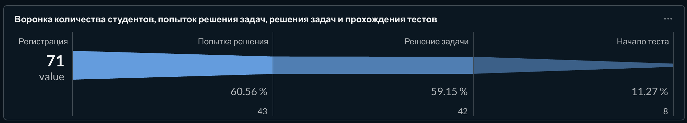
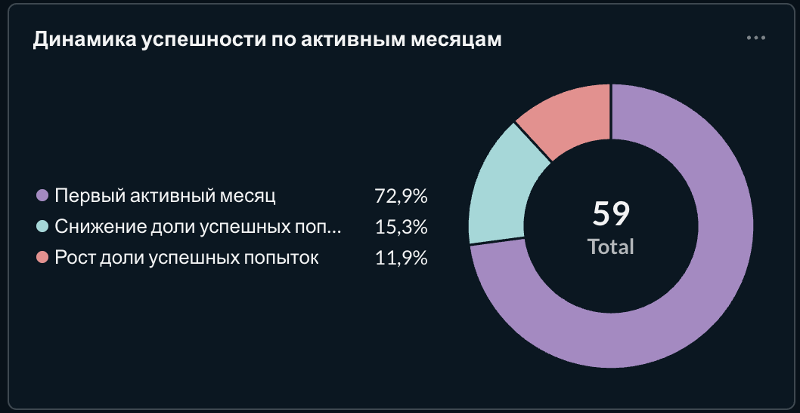
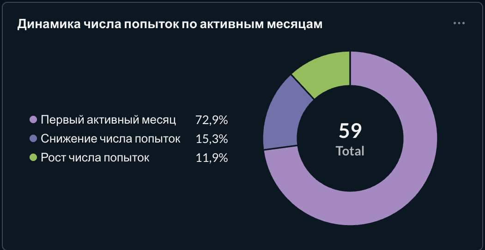
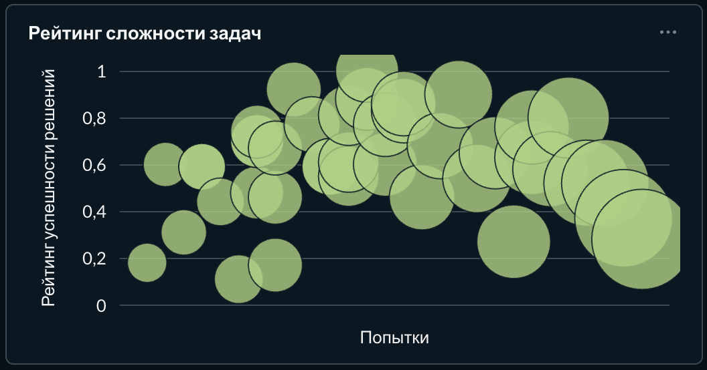
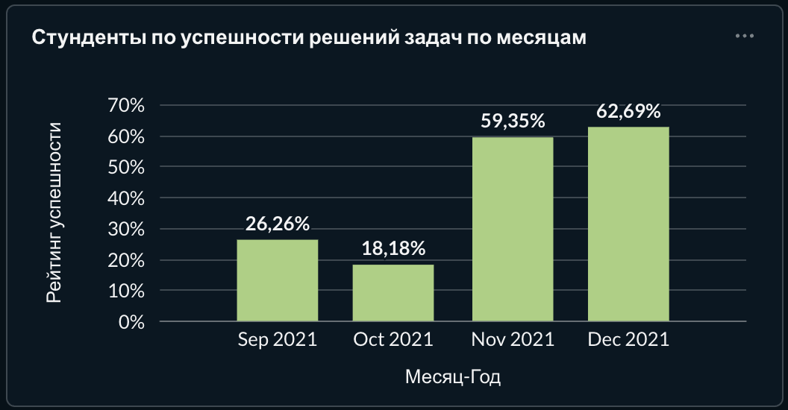
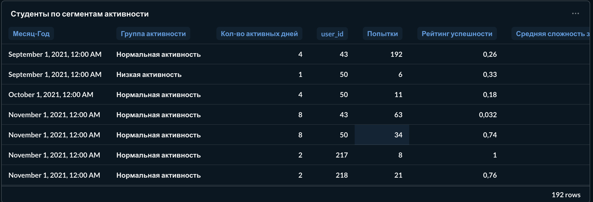

# Аналитика образовательной платформы IT Resume

Учебный SQL-проект, выполненный в рамках обучения в Simulative.

## Цель проекта

Исследовать поведение пользователей образовательной платформы:
онбординг, активность и успешность решения задач.
На основе анализа предложить направления улучшения обучения.

## Данные и инструменты

Анализ выполнен на учебной базе данных для корпоративного клиента
с `company_id = 1`.

Использованы таблицы пользователей, попыток решения задач,
сложности задач и начала тестирования.

**SQL:** синтаксис PostgreSQL, JOIN, CTE, агрегатные и оконные
функции, работа с датами, расчёт медианы.

## Разделы анализа

1. [Воронка онбординга](sql/01_onboarding_funnel.sql)
2. [Сложность задач](sql/02_problem_difficulty.sql)
3. [Успешность попыток по месяцам](sql/03_monthly_success_rate.sql)
4. [Динамика успешности](sql/04_success_rate_dynamics.sql)
5. [Динамика активности](sql/05_activity_dynamics.sql)
6. [Когортный анализ](sql/06_cohort_analysis.sql)
7. [Сегментация студентов](sql/07_student_segmentation.sql)

## Основные наблюдения

В исходном учебном исследовании отмечены:

- Потеря части пользователей между регистрацией и первой попыткой
  в месяце регистрации.
- Наличие задач с низкой долей успешных попыток.
- Колебания активности и успешности студентов по месяцам.
- Снижение поздней успешности относительно ранней у ряда когорт.

## Бизнес-рекомендации

- Проверить улучшения сценария начала обучения.
- Провести аудит задач с низкой долей успешных попыток.
- Проверить механики регулярного обучения и возвращения студентов.
- Исследовать разные учебные траектории для групп пользователей.

Эффект рекомендаций в рамках проекта не измерялся.

## Особенности расчётов

Доля успешных попыток не является прямой оценкой навыков студентов.
Сравнение активных месяцев пропускает месяцы без попыток.
Наблюдаемые связи не доказывают причинность.

Подробности расчётов указаны в комментариях к SQL-запросам.

## Подробный отчёт

[Методика, результаты анализа и бизнес-рекомендации](docs/analysis_report.md)

## Дашборд Metabase

Фрагменты дашборда за 2021 год.

### Онбординг

### Динамика успешности и активности

Диаграммы показывают распределение записей «студент — месяц».
Сравнение выполняется с предыдущим месяцем с попытками.

### Сложность задач

### Успешность попыток по месяцам

### Сегментация студентов

